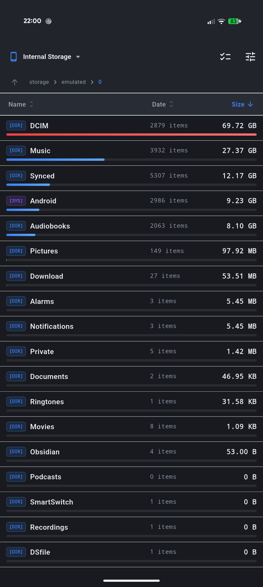
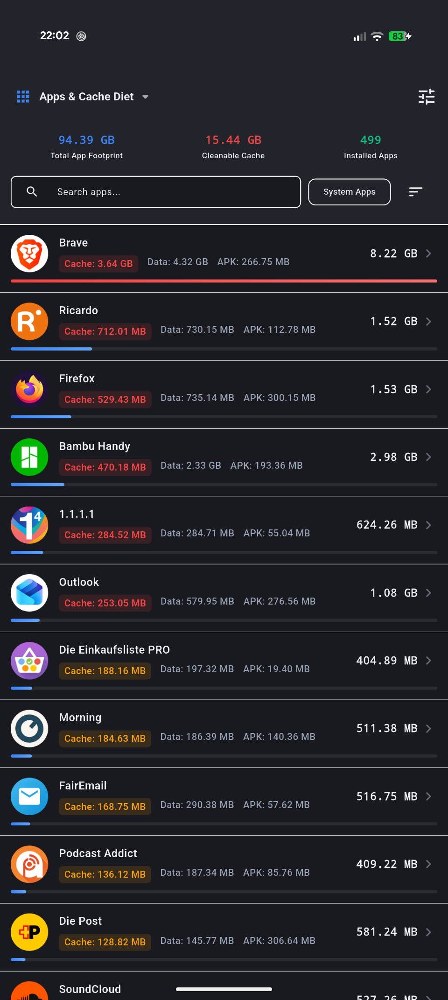
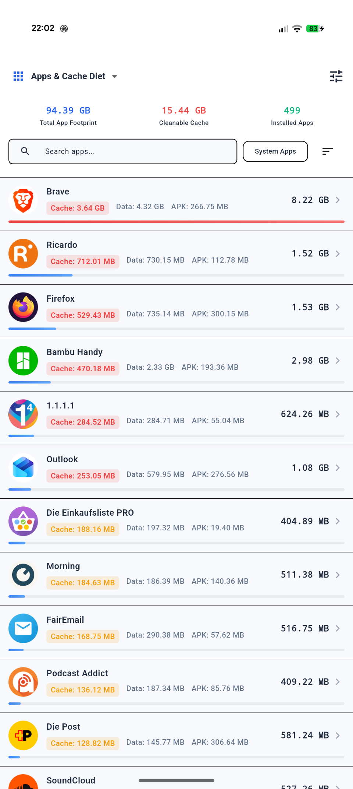
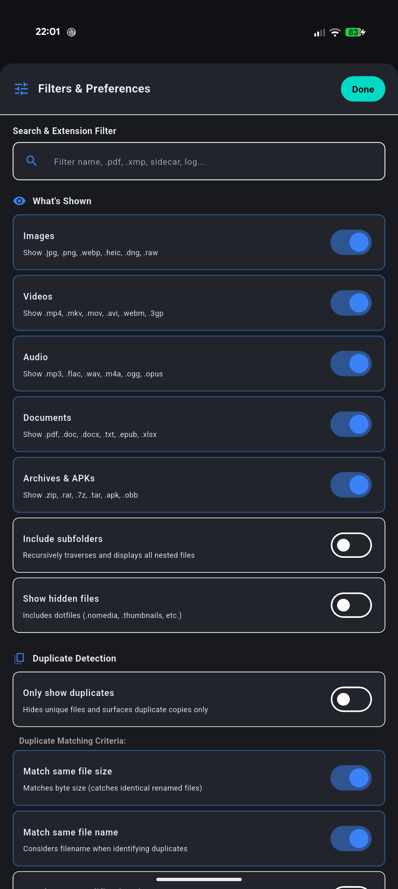

# FreeDataDiet Mobile

[](https://github.com/LycosLane/freedatadiet-mobile)
[](https://github.com/LycosLane/freedatadiet-mobile)
[](LICENSE)
[]()
[]()

> **The official mobile companion to [FreeDataDiet](https://github.com/LycosLane/freedatadiet).**  
> Put your mobile storage on a diet. Fast, private disk usage and app-cache analyzer for Android.  
> Find large files, clear cache, and remove duplicates with zero ads and zero tracking.

---

## Disk Explorer

<p align="center">
  
</p>

See which folders and files use the most space.
* **Visual size bars:** Color bars show heavy folders immediately.
* **Fast sorting:** Tap headers to sort by file size, date, or name.
* **Multiline names:** Pinch to zoom in. Long file names wrap so nothing is cut off.
* **Drag-to-select:** Touch and drag down to select multiple files at once.
* **Safe delete:** System directories and core Android folders are protected from deletion.

---

## App Diet

<p align="center">
  
  &nbsp;&nbsp;&nbsp;&nbsp;
  
</p>

See how much space apps use for their cache and storage. Supports both dark and light modes.
* **Find heavy caches:** Lists apps sorted from largest cache to smallest.
* **One-tap clear:** Tap any app to open Android system settings and clear its cache.
* **No fake cleaners:** Uses native Android system stats. No fake RAM boosters or battery tools.

---

## Filters and Duplicates

<p align="center">
  
</p>

Filter what you see and clean redundant files.
* **Category filters:** Turn off images, videos, or archives to focus on what matters.
* **Extension search:** Filter by file type like `.mp4`, `.pdf`, or `.zip`.
* **In-app preview:** Tap any photo to view it full-screen and zoom before deleting.
* **Duplicate grouping:** Subfolder duplicates are grouped with paths shown side by side.
* **Keep 1st:** Select extra duplicate copies with one tap.
* **Folder Assistant:** Cleaning a duplicate offers to select other duplicates in the same folder.

---

## Privacy and Security

* **No internet access:** The app does not request network permission (`android.permission.INTERNET`). Your files cannot leave your phone.
* **No ads:** No banners, no video popups, and no paid subscriptions.
* **No tracking:** No analytics, no crash reports sent to third parties, and no accounts.
* **Open source:** Free software under the MIT license. Read our [Privacy Policy](PRIVACY.md).

---

## Required Permissions

* **All Files Access (`MANAGE_EXTERNAL_STORAGE`):** Needed on Android 11+ to calculate folder sizes and delete selected files.
* **Usage Stats Access (`PACKAGE_USAGE_STATS`):** Needed to check app cache sizes directly from Android system settings.
* **Query All Packages (`QUERY_ALL_PACKAGES`):** Needed on Android 11+ to show installed apps in the App Diet tab.

---

## Build from Source

```bash
# Clone repository
git clone https://github.com/LycosLane/freedatadiet-mobile.git
cd freedatadiet-mobile

# Install dependencies
flutter pub get

# Run tests
flutter test

# Run on connected device
flutter run
```

---

## Related Projects

* **[FreeDataDiet (Desktop)](https://github.com/LycosLane/freedatadiet):** Fast disk space analyzer for Windows, Linux, and macOS written in Rust and egui.

---

## License

MIT License © 2026 LycosLane
